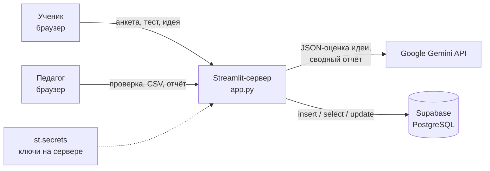

# 🎮 Геймификация в образовании — облачное веб-приложение исследования

Streamlit + Supabase (PostgreSQL) + Google Gemini API (`google-genai`).

## Архитектура



Ключи API хранятся только на сервере (`st.secrets`) и никогда не попадают в браузер.

## Файлы

| Файл | Назначение |
|---|---|
| `app.py` | приложение (вкладка ученика + кабинет исследователя) |
| `requirements.txt` | зависимости |
| `schema.sql` | создание таблицы в Supabase |
| `.streamlit/secrets.toml.example` | шаблон ключей |

## 1. Создание таблицы в Supabase

1. Зарегистрируйтесь на <https://supabase.com> → **New project** (запомните пароль БД, регион — ближайший, напр. Frankfurt).
2. Откройте **SQL Editor → New query**, вставьте содержимое `schema.sql`, нажмите **Run**.
3. Проверьте в **Table Editor**, что появилась таблица `gamification_results`.
4. Скопируйте ключи: **Project Settings → API**:
   - `Project URL` → `SUPABASE_URL`;
   - серверный ключ — **secret key** (`sb_secret_...`) или, в старых проектах, **service_role** → `SUPABASE_KEY`.

   RLS включён без публичных политик, поэтому anon/publishable-ключ здесь работать не будет —
   нужен именно серверный ключ. Никогда не публикуйте его в коде или в GitHub.

## 2. Ключ Gemini API

<https://aistudio.google.com/apikey> → **Create API key** → `GEMINI_API_KEY`.

Модель по умолчанию — `gemini-3.5-flash`. Если Google её выведет из обращения, укажите актуальную
в `GEMINI_MODEL` (список — на странице моделей в AI Studio); код менять не нужно.

## 3. Локальный запуск

```bash
python -m venv .venv && source .venv/bin/activate   # Windows: .venv\Scripts\activate
pip install -r requirements.txt
mkdir -p .streamlit && cp .streamlit/secrets.toml.example .streamlit/secrets.toml
# впишите свои ключи в .streamlit/secrets.toml
streamlit run app.py
```

Без ключей приложение тоже стартует: данные хранятся в памяти сессии, а идеи учеников уходят
на ручную проверку педагогу. Статус сервисов виден в боковой панели.

## 4. Развёртывание в облаке (Streamlit Community Cloud, бесплатно)

1. Создайте репозиторий на GitHub и загрузите `app.py`, `requirements.txt`, `schema.sql`, `README.md`.
   **Не загружайте** `.streamlit/secrets.toml` (добавьте его в `.gitignore`).
2. <https://share.streamlit.io> → **Create app** → выберите репозиторий, ветку, файл `app.py`.
3. **Advanced settings → Secrets** — вставьте:

   ```toml
   SUPABASE_URL = "https://xxxx.supabase.co"
   SUPABASE_KEY = "sb_secret_..."
   GEMINI_API_KEY = "AIza..."
   GEMINI_MODEL = "gemini-3.5-flash"
   TEACHER_PASSWORD = "придумайте-пароль"
   ```
4. **Deploy**. Через 1–2 минуты появится публичная ссылка `https://<имя>.streamlit.app` — её можно
   раздать участникам исследования.

## 5. Сценарий презентации

1. Вкладка **Кабинет исследователя** → войти по паролю → **Загрузить демо-данные** (12 респондентов).
2. Показать метрики и диаграммы.
3. Вкладка **Участник** → пройти анкету, получить оценку Gemini, ранг и задание следующего шага.
4. Вернуться в кабинет: исправить XP/комментарий ИИ, поставить галочку «Проверено» → **Сохранить**.
5. **Скачать CSV** (открывается в Excel без «кракозябр» благодаря `utf-8-sig`).
6. **Сгенерировать отчёт по выборке** → скачать `.md`.
7. Перед реальным сбором данных — **Удалить демо-данные**.

## Логика начисления XP и рангов

- Блиц-тест: 3 вопроса × 10 XP = до 30 XP.
- Идея урока (Gemini): до 50 XP — механики (15), связь с учебной целью (15), реализуемость (10), оригинальность (10).
- Ранги: 🧭 Искатель Знаний (0–29) · 🛠️ Архитектор Квестов (30–59) · 🏆 Грандмастер Геймификации (60+).
- Педагог может изменить XP от ИИ — общий XP и ранг пересчитываются при сохранении.
